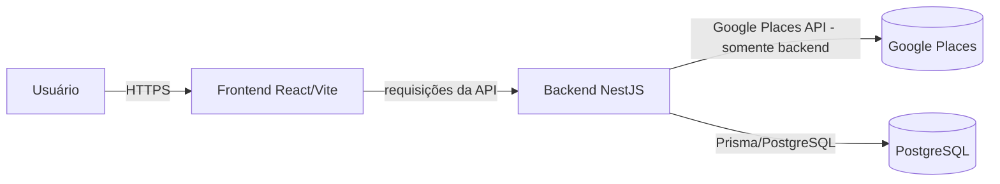

# Arquitetura — Leads Generator

## Objetivo e escopo

Sistema web para gerar e gerenciar leads empresariais: busca de empresas por segmento e localização (via Google Places API), seleção e organização de leads, registro de status e observações, listas de prospecção, pipeline, exportação em CSV/XLSX, acompanhamento de consumo da API e auditoria de ações sensíveis.

## Estado atual vs. arquitetura planejada

**Importante:** os recursos de negócio **ainda não estão implementados**. Este repositório contém apenas a fundação. Endpoints e rotas citados abaixo são **planejados**; não existem em runtime hoje.

**Implementado (fundação):**

- Monorepo pnpm workspaces (apps/web, apps/api, apps/e2e, packages/contracts, packages/eslint-config, packages/typescript-config, infrastructure, docs, scripts, openspec).
- TypeScript estrito compartilhado; ESLint flat (base/React/Node); Prettier.
- Qualidade: Husky + lint-staged (pre-commit), Playwright config, gates `pnpm check`.
- Segredos: `.env.example` por app/infra; detecção de segredos via `scripts/check-secrets` (secretlint).
- Desenvolvimento local: PostgreSQL em container via `infrastructure/docker-compose.dev.yml`.
- **API (shell NestJS seguro de runtime):** fail-fast de configuração, `GET /health` mínimo, headers Helmet/CSP/HSTS, CORS por allowlist, limites de corpo, ValidationPipe, contrato de erros centralizado, request ID server-generated, rate limit global e shutdown ordenado. Autenticação do administrador único (sessão opaca por cookie, Argon2id, CSRF, sessão única, anti-enumeração). Detalhes da superfície pública e limites em [`docs/architecture/api.md`](api.md). **Não há** Google Places, leads ou frontend nesta fase inicial — o frontend foi adicionado por `visual-foundation-and-layout`.
- **Frontend (`apps/web`):** React 19 + Vite 7 + TypeScript estrito + Tailwind + design system próprio; cliente de API tipado (fetch + Zod), autenticação em memória (cookie HttpOnly, CSRF em memória), rotas públicas/protegidas com guard, login, dashboard em estado vazio, troca de senha, logout, layout desktop/mobile acessível. Detalhes em [`docs/architecture/web.md`](web.md).

**Planejado (mudanças futuras):** busca Google Places (`places-search`), gestão de leads, listas e pipeline, exportação, auditoria/observabilidade, hardening de produção e CI.

## Monorepo — responsabilidade de cada workspace

| Workspace                    | Responsabilidade                                                                          |
| ---------------------------- | ----------------------------------------------------------------------------------------- |
| `apps/web`                   | Frontend (React + Vite). Nunca acessa Google Places; nunca recebe segredos.               |
| `apps/api`                   | Backend (NestJS). Único componente que acessa Google Places e o banco.                    |
| `apps/e2e`                   | Testes end-to-end (Playwright) contra a API e o frontend reais no banco de teste isolado. |
| `packages/contracts`         | Contratos compartilhados entre API e web (tipos/DTOs).                                    |
| `packages/eslint-config`     | Configurações ESLint compartilhadas (base/React/Node).                                    |
| `packages/typescript-config` | Configurações TypeScript estritas compartilhadas (base/web/api).                          |
| `infrastructure`             | Docker Compose de desenvolvimento (PostgreSQL).                                           |
| `docs`                       | Arquitetura, segurança e decisões (ADRs).                                                 |
| `scripts`                    | Utilitários de verificação (workspaces, segredos).                                        |
| `openspec`                   | Especificações e mudanças (Spec-Driven Development).                                      |

## Limites de responsabilidade

- **Google Places é acessado exclusivamente pelo backend.** A chave da API existe somente no backend, carregada por variável de ambiente. Nenhuma chave ou segredo chega ao frontend, a respostas da API, a logs ou a testes. **Nível de repositório (implementado):** a variável é declarada apenas no template do backend e ausente do frontend. **Runtime (planejado):** as chamadas e respostas reais ao Google serão implementadas em `places-search`.
- O frontend depende de uma abstração de busca de estabelecimentos fornecida pela API; não acopla ao provedor (Google).
- O backend é a única fronteira com serviços externos e com o banco de dados.
- Nada enviado pelo navegador é tratado como confiável: roles, ids de usuário/owner e permissões são determinados e validados no backend.

## Fluxo planejado: frontend → backend → Google Places

1. O frontend solicita a busca de empresas ao backend.
2. O backend consulta a Google Places API (com chave do ambiente, timeout e seleção de campos).
3. O backend normaliza e retorna apenas os dados necessários — sem expor a chave.

## Fluxo: backend → PostgreSQL

- Em desenvolvimento, o PostgreSQL roda em container e a API (executada no host) conecta-se via loopback: **`127.0.0.1:5433` no host → porta interna `5432` no container**.
- A publicação é **somente em loopback**; o banco não fica acessível por outras interfaces.
- **Em produção o PostgreSQL não possui porta publicada**; a conexão ocorre pela rede interna.
- Persistência em volume nomeado; processo do PostgreSQL executa sem root; healthcheck via `pg_isready`.

## Fronteiras de confiança

- **Navegador (não confiável) → API (confiável):** toda entrada é validada e autorizada no backend.
- **API → Google Places (externo):** chamadas controladas (timeout, campos explícitos, tratamento de quotas).
- **API → PostgreSQL (interno):** consultas parametrizadas; acesso restrito.

A segurança não depende de ocultação: nomes de rotas, bundle do frontend e chamadas públicas podem ser inspecionados. A proteção efetiva reside no backend e na infraestrutura.
